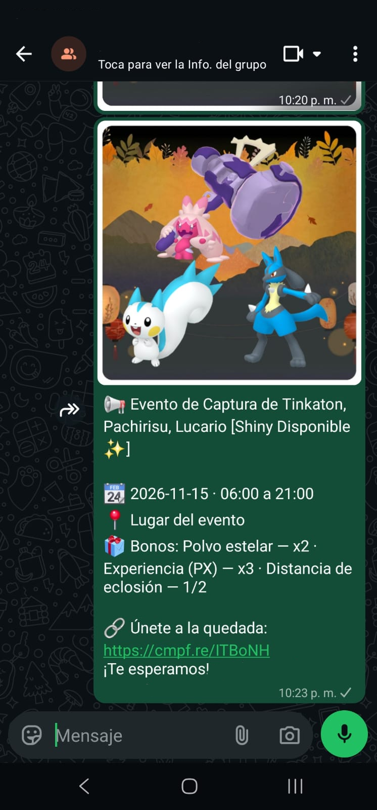
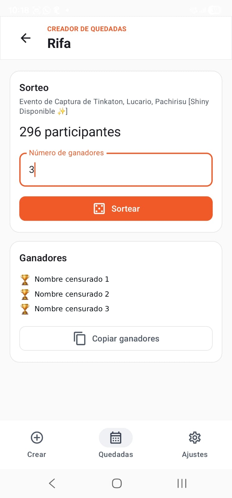
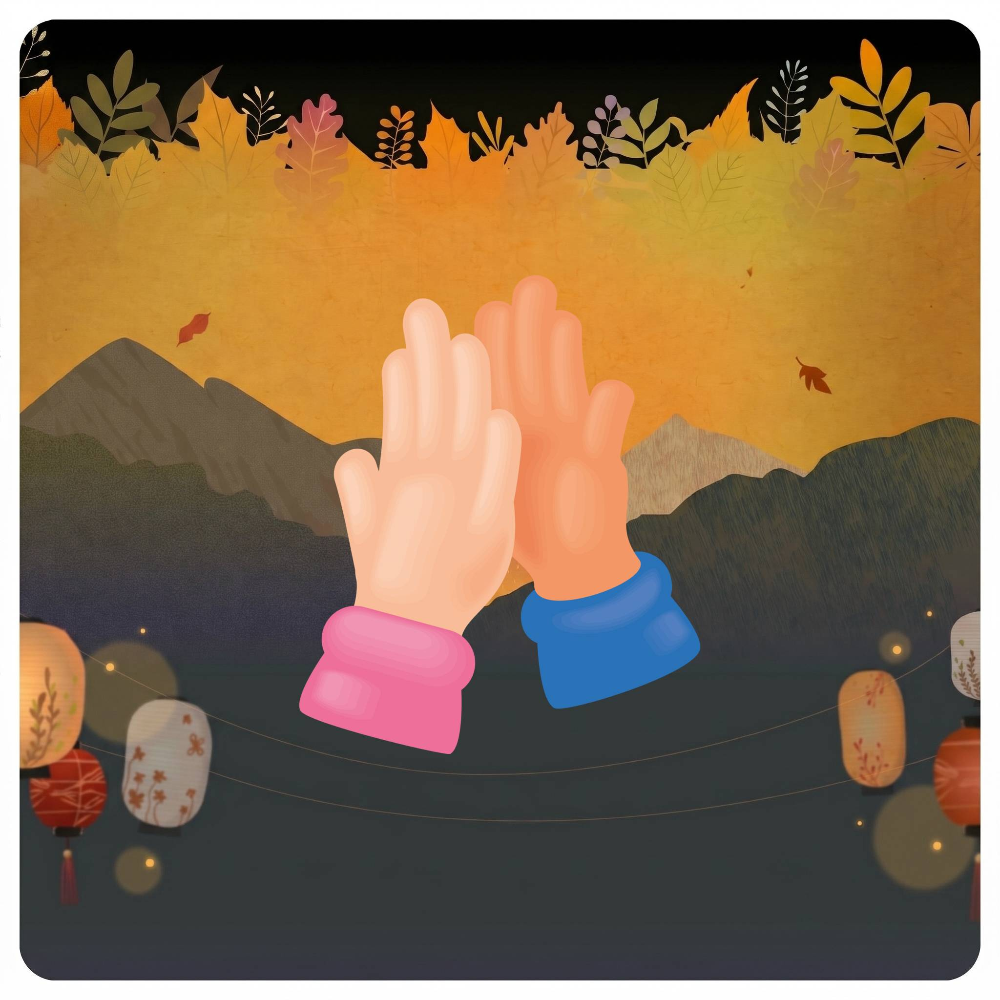

# Campfire Meetup Creator

**An Android companion app for organizing Pokémon GO community meetups — from event artwork to attendance exports.**

Originally developed to streamline the planning of meetups for a local Pokémon GO community, it is designed to be customizable for other communities as well.

> **Independent community project.** Not affiliated with, sponsored by, or endorsed by Niantic, Scopely, The Pokémon Company, or Nintendo. Campfire Tools is a separate third-party service.

## Overview

Preparing an event means more than setting a date: organizers need artwork, a title and description, a Campfire link, a shareable invitation, and eventually a way to review attendance. Campfire Meetup Creator brings those tasks into a single Android workflow.

**Create artwork → Configure meetup → Copy details into Campfire → Save event link → Share → Review attendance → Export.**

## Screenshots

_Add screenshots to [`screenshots/`](screenshots/). The README previews below will appear once the named files have been added._

| Image generator | Meetup details | Share invitation |
|---|---|---|
|  |  |  |

| Meetup history | Meetup details and attendance | Raffle |
|---|---|---|
|  |  |  |

Additional views: [Campfire link](screenshots/07-campfire-link.png) · [Community settings](screenshots/08-settings.png)

## Features

### Artwork and event preparation
- Generate a square event image with **0–3 Pokémon**; zero-Pokémon mode is designed for social meetups.
- Use a seasonal event background or a separate social-event photograph, both changeable from Settings.
- Save images to the device gallery.
- Choose predefined event categories or create a custom category.
- Edit the suggested title, including an optional **Shiny Disponible ✨** tag.
- Build event descriptions with date, time, location, and one or more bonuses; add custom bonus names and values.

### Sharing and meetup records
- Copy titles and descriptions to create events manually in Campfire.
- Save the Campfire link and share an invitation with text and image using Android's share sheet (including WhatsApp).
- Keep a local meetup history, view details, edit and delete records.
- Configure a community name and default meetup location.

### Attendance and data export
- Retrieve attendance for a single meetup or download missing data for completed meetups via **Campfire Tools**, subject to its availability.
- Keep check-in and RSVP data locally, including checked-in participants and accepted registrations without check-in when provided by the external source.
- View check-in totals, accepted totals, and the check-in rate.
- Export **meetup information only** to CSV, **one meetup with attendance** to ZIP, or **all stored meetup data** to ZIP.
- Import attendee data from a local CSV when needed.
- Draw raffle winners from a meetup's locally stored attendee list; raffle results reset when leaving the raffle screen.

**Attendance terminology:** A person with `CHECKED_IN` is counted among check-ins. The accepted total can include both checked-in participants and people whose RSVP remains `ACCEPTED` without check-in. For example, 296 check-ins and 54 accepted without check-in correspond to 350 accepted and a rounded check-in rate of 85%.

## Download and installation

See [Releases](../../releases) for distributable builds, if available.

1. Download the APK from a release.
2. Open it on an Android device running **Android 10 (API 29) or later**.
3. If prompted, permit installation from the chosen source.
4. The app starts with two bundled, neutral backgrounds: one for standard Pokémon events and one for social events. You can change either image later in **Ajustes**.
5. Optionally set your community name and usual meetup location in **Ajustes**.

Android may display a security warning for APKs installed outside an app store. Only download releases from a repository you trust.

## Default artwork and first launch

The app includes two **generic, unbranded starter backgrounds** so new users can generate their first meetup image immediately, without uploading artwork during setup.

| Default seasonal background | Default social background |
|---|---|
|  |  |

- **`temporada.jpg`** — Used for regular meetup artwork with one, two, or three Pokémon layered on top. It intentionally has **no community logo** so anyone can reuse it.
- **`social.jpg`** — Used when **Evento social** is enabled (zero Pokémon), including *Viernes de Amigos*. The image already contains a friendship illustration and is used without a Pokémon sprite.
- **First use:** No background setup is required when both files are bundled. In **Ajustes**, organizers can replace either background with their community's seasonal design or a group photograph. The selected image is saved locally on that device.
- **No background history:** Changing a background replaces the active selection; users do not need to manage a collection of past seasonal backgrounds.

### Where to place the background files

For Android Studio, place the two files **inside the app's assets directory** with these exact paths and names:

```text
app/src/main/assets/fondos/
├── temporada.jpg
└── social.jpg
```

`ImageEngine.kt` in the current Android implementation looks for **`fondos/temporada.jpg`** when Pokémon are selected and **`fondos/social.jpg`** in social mode, **provided that no custom image has already been chosen in Settings**. The filenames and extensions must match. These assets are packaged in the APK when you build the project; merely adding them to a GitHub README does not install them into the app.

This repository also displays documentation copies in `docs/images/` for the README preview. Those are **separate** from the assets used by the Android app.

If you previously chose a custom background in an existing installation, the saved choice takes precedence over the bundled default. Use **Ajustes** to choose a new image. Installing an APK update does not automatically clear that preference.

### Replacing the starter artwork

- **For your own compiled APK:** Replace the two JPG files at the paths above **before building**, preserving their filenames. Square images work best (the supplied examples are 2048 × 2048 px). No code changes are required.
- **For other communities using the installed app:** Go to **Ajustes → Cambiar fondo de temporada** or **Cambiar foto social**, and select an image from the phone. The app uses the newly selected image for future creations; old exported event images are not retroactively changed.
- **For a public GitHub repository:** The two generic, unbranded images shown here are included as starter examples. Do not publish private community photos or artwork without the necessary permissions. If publishing the files under a source-code license, verify that it also covers those images or state their separate license terms.

## Built with

- **Kotlin** and **Jetpack Compose**
- **Material 3** components
- **Android SDK** and Android sharing/gallery APIs
- **Local JSON storage** for meetup records
- **Campfire Tools** for external meetup attendance retrieval

## Building from source

1. Clone this repository and open it in **Android Studio**.
2. Allow Gradle to synchronize.
3. Verify `app/src/main/assets/fondos/temporada.jpg` and `app/src/main/assets/fondos/social.jpg` exist, together with any required, appropriately licensed Pokémon assets (see **Default artwork and first launch** and **Assets and attribution**).
4. Select a device or emulator and click **Run**.

The source may not produce the same artwork as the distributed application unless the required, appropriately licensed image assets are provided. Never include a signing keystore or private credentials in the repository.

## Data and privacy

- Meetup information and imported attendance are stored on the user's device; an account is not required for the local workflow.
- Retrieving attendance requires internet access to Campfire Tools. The external service's own policies and availability apply.
- Attendance exports can contain player identifiers and participation history. **Do not commit real exports, player CSV files, or personal records to Git.**
- The app does not automatically publish local participation records to this repository.
- Before removing or reinstalling the application, back up records you need. CSV/ZIP export does not necessarily provide an in-app restore feature.

## Assets and attribution

Pokémon names, character artwork, and related intellectual property belong to their respective owners. The app is an independent organizer utility; the source-code license, if any, does **not** grant rights to third-party artwork or sprites.

Review licenses and permissions before distributing Pokémon sprites, seasonal artwork, photographs, or APKs containing those assets. A repository that omits the sprites may still have an APK containing them.

## Limitations

- Campfire event creation is **manual**; the app prepares content and stores the resulting link.
- Campfire Tools is an independent service. API formats, access, availability and historical attendance can change.
- Stored RSVP and check-in information reflects what the external service returned at the time it was retrieved; it may not represent a historical pre-event snapshot.
- Exporting records is not the same as restoring the entire app state.

## Project background

This project started as an internal image generator to reduce repetitive work when creating Pokémon GO meetups. It expanded into a mobile workflow for image preparation, event description generation, invitation sharing, local meetup history, attendance retrieval, exports, and raffles.

**The goal:** help community organizers spend less time on repetitive administration and more time running their events.
