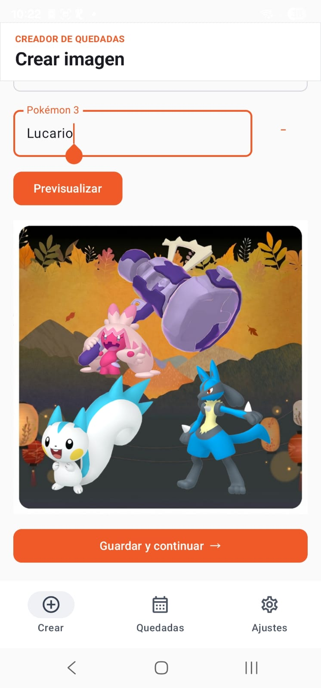
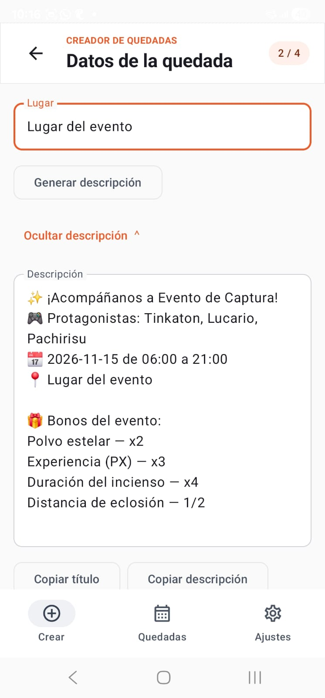
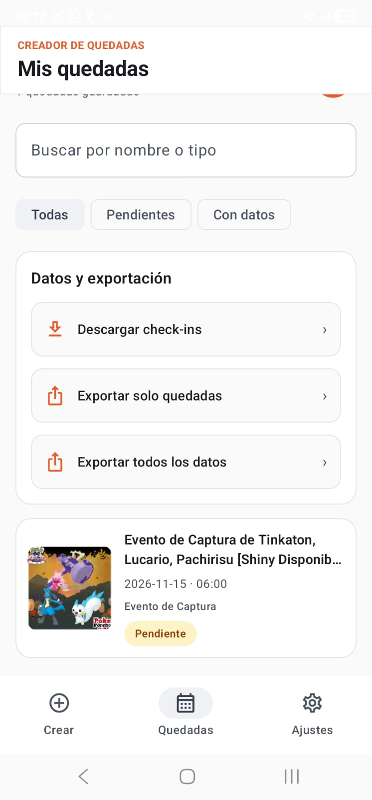
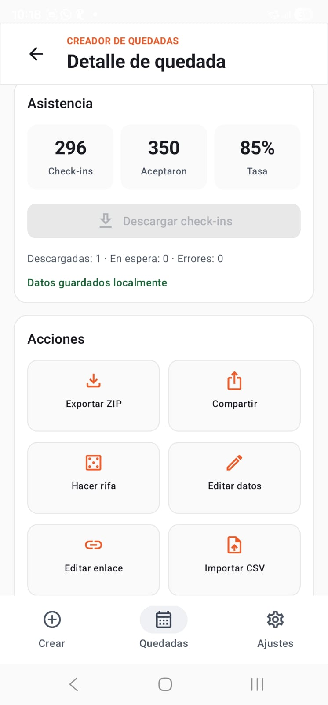
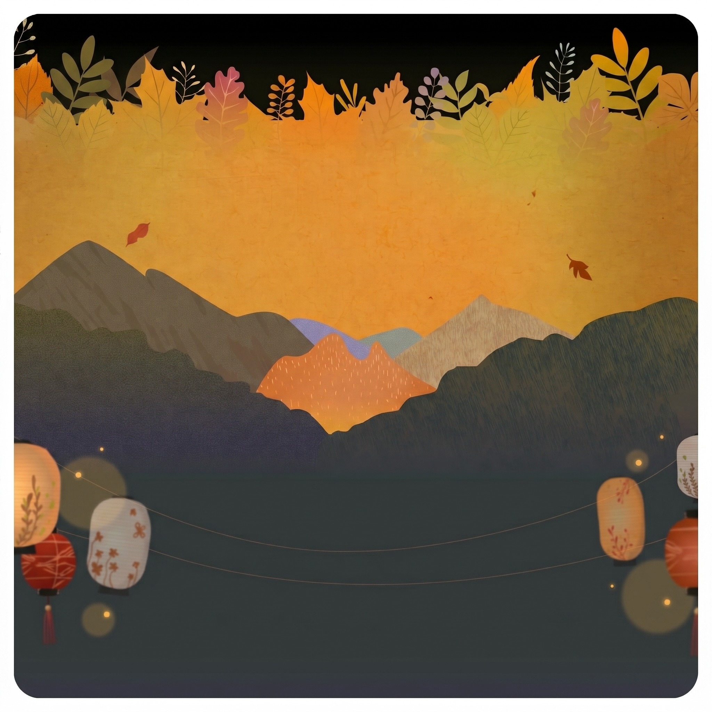

# Campfire Meetup Creator

**An Android companion app for organizing Pokémon GO community meetups — from event artwork to attendance exports.**

Originally developed to streamline meetup planning for a local Pokémon GO community, it is customizable for other communities as well. *(Note: The app interface is currently available in Spanish only.)*

> **Independent community project.** Not affiliated with, sponsored by, or endorsed by Niantic, Scopely, The Pokémon Company, or Nintendo. Campfire Tools is a separate third-party service.

## Overview

Preparing an event requires more than setting a date: organizers need artwork, a title and description, a Campfire link, a shareable invitation, and a way to review attendance. Campfire Meetup Creator brings those tasks into a single Android workflow:

**Create artwork → Configure meetup → Copy details into Campfire → Save event link → Share → Review attendance → Export**

## Screenshots

| Image generator | Meetup details | Share invitation |
|---|---|---|
|  |  |  |

| Meetup history | Meetup details and attendance | Raffle |
|---|---|---|
|  |  |  |

Additional views: [Campfire link](screenshots/07-campfire-link.png) · [Community settings](screenshots/08-settings.png)

## Features

### Artwork and event preparation
- Generate a square event image with **0–3 Pokémon** (zero-Pokémon mode is designed for social meetups).
- Use a seasonal event background or a separate social-event photograph, both customizable from **Ajustes** (Settings).
- Save generated images directly to the device gallery.
- Choose predefined event categories or create custom ones.
- Edit suggested titles, including an optional **Shiny Disponible ✨** (Shiny Available) tag.
- Build event descriptions with date, time, location, and customizable bonuses.

### Sharing and meetup records
- Copy formatted titles and descriptions to create events manually in Campfire.
- Save the Campfire event link and share an invitation (text + image) via Android's share sheet (WhatsApp, Telegram, etc.).
- Maintain a local meetup history with full view, edit, and delete support.
- Configure a default community name and meetup location.

### Attendance and data export
- Retrieve attendance for a single meetup or batch-download missing data for completed meetups via **Campfire Tools**.
- Store check-in and RSVP data locally (`CHECKED_IN` counts toward actual check-ins; `ACCEPTED` includes both checked-in players and unconfirmed RSVPs).
- View check-in totals, accepted totals, and check-in rates.
- Export **meetup info only** (CSV), **a single meetup with attendance** (ZIP), or **all stored data** (ZIP).
- Import attendee lists from a local CSV file.
- Draw raffle winners from a meetup's local attendee list (results reset upon leaving the raffle screen).

## Download and installation

Check the [Releases](../../releases) page for the latest APK.

1. Download the APK on a device running **Android 10 (API 29) or later**.
2. Open the file and allow installation from unknown sources if prompted.
3. *(Optional)* Set your community name, default location, and custom backgrounds in **Ajustes** (Settings).

> Android displays a standard security warning for APKs installed outside Google Play. Only download releases from repositories you trust.

## Default artwork

The app bundles two unbranded starter backgrounds (2048 × 2048 px) so organizers can generate images immediately without initial setup:

| Default seasonal background (`temporada.jpg`) | Default social background (`social.jpg`) |
|---|---|
|  |  |

- **`temporada.jpg`:** Used for standard meetups featuring 1–3 Pokémon sprites.
- **`social.jpg`:** Used when **Evento social** (Social event — 0 Pokémon) is enabled, such as *Viernes de Amigos* (Friends Friday).

You can replace either image at any time via **Ajustes → Cambiar fondo de temporada** (Change seasonal background) or **Cambiar foto social** (Change social photo). Custom selections are stored locally and persist across APK updates.

## Built with

- **Kotlin** & **Jetpack Compose** (Material 3)
- **Android SDK** (MediaStore & ShareSheet APIs)
- **Local JSON storage** for offline persistence
- **Campfire Tools** integration for attendance retrieval

## Building from source

1. Clone this repository and open it in **Android Studio**.
2. Let Gradle sync dependencies.
3. Ensure the starter backgrounds exist inside `app/src/main/assets/fondos/`:
   ```text
   app/src/main/assets/fondos/
   ├── temporada.jpg
   └── social.jpg
   ```
   *(To customize defaults in your own build, replace these files while keeping the exact filenames.)*
4. Select a target device or emulator and click **Run**.

## Data, privacy, and limitations

- **Local-first:** All meetup records and imported attendance lists stay on your device; no account is required.
- **No full-state restore:** CSV/ZIP exports are intended for reporting and archiving, not for restoring app backups on a new installation.
- **Manual Campfire creation:** The app prepares titles, descriptions, and artwork, and stores the event URL, but does not publish events directly to Campfire.
- **Third-party dependency:** Attendance retrieval requires an internet connection and relies on Campfire Tools, whose availability, data format, and policies are external to this app. Exports may contain player identifiers—handle them responsibly.

## Assets and attribution

Pokémon names, character sprites, and related intellectual property belong to Nintendo, Creatures Inc., GAME FREAK inc., and The Pokémon Company. This project is an independent community utility.

## Project background

This project began as a simple tool to eliminate repetitive graphic design work when announcing local Pokémon GO meetups, eventually growing into a complete mobile workflow for event preparation, sharing, attendance tracking, exports, and community raffles.
